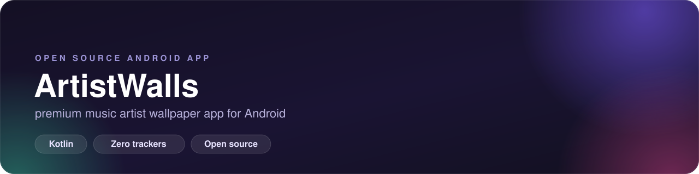

<div align="center">




<a href="https://github.com/technicalnihilist-lgtm/ArtistWalls/stargazers"></a>&nbsp;<a href="https://github.com/technicalnihilist-lgtm/ArtistWalls/network/members"></a>

<a href="https://github.com/technicalnihilist-lgtm/ArtistWalls/releases/latest/download/ArtistWalls-1.0.6.apk"></a> <a href="https://technicalnihilist-lgtm.github.io/apps-site/apps/ArtistWalls.html"></a>

<b>Support the work</b>

  

<sub>Donations aren't live yet — Paytm, UPI, PayPal and Buy&nbsp;Me&nbsp;a&nbsp;Coffee all show <b>coming soon</b>. Until then, a ⭐ star is the best support.</sub>

<a href="https://github.com/technicalnihilist-lgtm/ArtistWalls/releases/latest"></a>  <a href="https://github.com/technicalnihilist-lgtm/ArtistWalls/releases"></a>

</div>

---

## Download

**[ArtistWalls 1.0.6 — signed APK](https://github.com/technicalnihilist-lgtm/ArtistWalls/releases/latest)**

`com.artistwalls.app` · versionCode 7 · versionName 1.0.6 · minSdk 24 (Android 7.0) · targetSdk 35 · 8.8 MB
SHA-256 `836bd01b60bd885e5311ad5c0641078957d712af1560c732ce74f032b3e46f9d`

Installs straight over 1.0.1–1.0.3 — same signing certificate.

---

## Web version

The same app as a single self-contained HTML file — same catalogue, same licence gate,
same credits, same AMOLED design. It talks to the Commons API through its CORS endpoint
(`origin=*`), so it needs no server, no build step and no API key.

**Live:** https://technicalnihilist-lgtm.github.io/ArtistWalls/
**File:** [`docs/index.html`](docs/index.html) — open it directly in any browser.

Differences from the Android build, stated plainly: there is no `WallpaperManager` on the
web, so **Download** saves the original file to your device and you set it from the gallery.
Favourites, saved files and history live in `localStorage`. Everything else — live
discovery, licence filtering, attribution, pagination, search, collections, daily
wallpaper — is the same logic, ported to JavaScript.

---

## 1. What it does

| Area | Behaviour |
| --- | --- |
| Image source | Wikimedia Commons `action=query` API — `generator=search` + `prop=imageinfo&iiprop=url\|size\|mime\|extmetadata` |
| Live updates | No image list is stored on the server or in the app. Feeds are re-queried on every visit (5-minute in-memory page cache), and "Recently added" is sorted by `create_timestamp_desc`, so new uploads appear on their own |
| Licence gate | Only Public domain, CC0, CC BY and CC BY-SA pass. Non-free, fair use, album covers, unknown and NC/ND files are dropped before they reach the UI |
| Attribution | Artist · image title · photographer/creator · licence + licence URL · Commons file page · modification note, on every wallpaper and on a dedicated Credits screen |
| Wallpaper | Real download of the original file, then `WallpaperManager.setBitmap` for home / lock / both |
| Library | Favourites, offline copies and recently viewed are persisted in Room **with their credits**, so attribution and browsing work with no network |
| Search | Live Commons search with pagination, plus artist suggestions from the catalogue and Wikipedia OpenSearch |
| Collections | 12 dynamic collections (Bollywood, classical, composers, guitarists, pianists, drummers, rock bands, pop, legendary, female, male, live) |

## 2. Screens

- **Home** — logo, search bar, daily artist wallpaper hero, featured artists, popular
  Indian singers, trending wallpapers, international artists, legendary musicians,
  twelve collections, recently added, licensing note. Pull to refresh.
- **Search** — live suggestions, artist and collection matches, recent searches,
  paginated result grid, empty state when Commons has no licensed photograph.
- **Artist detail** — cinematic header, artist name and tagline, live gallery with
  pagination, Wikipedia biography link, related artists, full image-credit list.
- **Wallpaper detail** — full-screen preview, download with progress, set home / lock /
  both, favourite, share (image + credit text), resolution and megapixels, photographer,
  licence chip, original source link, modification note.
- **Library** — favourites / offline / recently viewed.
- **Credits** — licence policy, per-image credits from your library, links to Commons
  and Creative Commons.

## 3. Design language

AMOLED black canvas (`#000000`), dark glass panels (6–12% white fill, 1 dp hairline
border, no heavy blur), a serif display face for artist names against a clean sans for
UI text, and two restrained metallic accents — champagne gold `#C9A227` and silver
`#B9C0C9`. No bright colours, no rainbow gradients, minimal line icons.

## 4. Build

Requirements: JDK 17, Android SDK 35 (`platforms;android-35`, `build-tools;35.0.0`).

```bash
./gradlew assembleDebug          # app/build/outputs/apk/debug/app-debug.apk
./gradlew installDebug          # to a connected device / emulator
./gradlew assembleRelease       # unsigned release, minified + resource-shrunk
```

Open the folder in Android Studio (Ladybug or newer) and press Run — the Gradle wrapper
is included. `local.properties` is generated by Studio; or set `ANDROID_HOME`.

This project was compiled in CI-style from a clean checkout: `:app:compileDebugKotlin`
and `:app:processDebugResources` both succeed (KSP/Room code generation included).

## 5. Architecture

```
data/
  model/        Wallpaper, Credit, LicenseInfo, Artist, WallpaperCategory, ImageQuality
  catalog/      ArtistCatalog — 31 artists + 12 collections, each with a query chain
  remote/       WikimediaApi (Retrofit), DTOs, CommonsMapper, LicensePolicy, SuggestionService
  repo/         WallpaperRepository (live feeds, pagination, dedupe, retry, daily pick),
                ArtistImageCache
  local/        Room: LibraryEntry + LibraryDao + ArtistWallsDatabase, PreferencesStore
  download/     DownloadManager (OkHttp streaming, progress, offline file index)
  wallpaper/    WallpaperSetter (WallpaperManager, sampled decode)
  share/        ShareHelper (FileProvider, credit caption)
di/             AppContainer — manual dependency container (no Hilt, no reflection)
ui/
  theme/        AMOLED palette, editorial typography, dark-only Material 3 scheme
  components/   glass modifiers, cards, badges, empty/error states, brand mark
  navigation/   Routes + NavHost + glass bottom bar
  screens/      home, search, category, artist, wallpaper, library, credits
```

Design notes:

- **Manual DI.** `AppContainer` is created once in `ArtistWallsApp` and reached through a
  `CompositionLocal`, so there is no annotation processor beyond Room's KSP.
- **One immutable model.** `Wallpaper` carries its own `Credit`, so a wallpaper cannot
  be displayed without attribution — the compiler enforces it.
- **Credit survives offline.** `LibraryEntry` stores the credit columns, and
  `toWallpaper()` rebuilds a full `Wallpaper` from Room.
- **Duplicate prevention.** The Commons file title (`File:…`) is the primary key for
  dedupe, favourites, downloads and navigation.
- **Resilient feeds.** Each artist/collection carries a chain of Commons queries; the
  repository remembers which one worked and keeps paginating with it. A feed never
  breaks because a category was renamed.
- **Retry.** Every API call retries three times with backoff before the UI shows an
  error with a "Try again" action.

## 6. Adding artists

Edit `data/catalog/ArtistCatalog.kt`:

```kotlin
artist("new-slug", "Artist Name", ArtistGroup.INDIAN, "Wikipedia_Page_Title", "Short tagline")
```

The helper builds the Commons query chain and the relevance tokens automatically.
Then run `python3 tools/verify_licenses.py --artist "Artist Name"` to confirm that a
licensed photograph exists before you ship the entry.

## 7. Licence verification tool

```bash
python3 tools/verify_licenses.py                       # every artist and collection
python3 tools/verify_licenses.py --artist "Adele"      # one artist
python3 tools/verify_licenses.py --json report.json    # machine-readable report
```

It runs the same queries, the same licence policy and the same minimum-resolution rule
as the app, so its output is exactly what the app will display. No dependencies beyond
the Python standard library. See `VERIFICATION.md` for the last run.

## 8. Permissions

`INTERNET`, `ACCESS_NETWORK_STATE` (live discovery), `SET_WALLPAPER`,
`SET_WALLPAPER_HINTS` (applying a wallpaper). Downloads go to app-private external
storage, so no storage permission is ever requested on any supported API level.

## 9. Attribution and copyright

ArtistWalls does not own any artist photograph and never claims to. Read
[LICENSING.md](LICENSING.md) for the full policy, including the ShareAlike position,
the "no modification" statement and how to report an image.

---

## 🌍 Languages

<sub>Donations are <b>coming soon</b> in every language below — nothing to pay today, nothing to click.</sub>

<div align="center">

<sub><b>हिन्दी · বাংলা · मराठी · తెలుగు · தமிழ் · ગુજરાતી · ಕನ್ನಡ · മലയാളം · ਪੰਜਾਬੀ · ଓଡ଼ିଆ · অসমীয়া · اردو</b></sub>

</div>

<details>
<summary><b>🌍 Open the same message in 53 languages</b></summary>

**🇮🇳 Indian languages**

- **हिन्दी** (Hindi) — ☕ जल्द ही आ रहा है। · ⭐ अगर आपको यह ऐप और हमारा काम पसंद है, तो कृपया रिपॉजिटरी को स्टार दें और हमें फॉलो करें।
- **বাংলা** (Bengali) — ☕ খুব শিগগিরই আসছে। · ⭐ যদি আপনার এই অ্যাপ এবং আমাদের কাজ ভালো লাগে, তবে অনুগ্রহ করে রিপোজিটরিটিকে একটি স্টার দিন এবং আমাদের ফলো করুন।
- **मराठी** (Marathi) — ☕ लवकरच येत आहे. · ⭐ जर तुम्हाला हे ॲप आणि आमचं काम आवडलं असेल, तर कृपया रिपॉझिटरीला स्टार द्या आणि आम्हाला फॉलो करा.
- **తెలుగు** (Telugu) — ☕ త్వరలో రాబోతోంది. · ⭐ మీకు ఈ యాప్, మా పని నచ్చితే, దయచేసి రిపోజిటరీకి ఒక స్టార్ ఇచ్చి మమ్మల్ని ఫాలో అవ్వండి.
- **தமிழ்** (Tamil) — ☕ விரைவில் வருகிறது. · ⭐ உங்களுக்கு இந்த ஆப்பும் எங்க வேலையும் பிடிச்சிருந்தா, தயவுசெஞ்சு இந்த ரெபாசிட்டரிக்கு ஒரு ஸ்டார்…
- **ગુજરાતી** (Gujarati) — ☕ ટૂંક સમયમાં આવી રહ્યું છે. · ⭐ જો તમને આ એપ અને અમારું કામ ગમતું હોય, તો પ્લીઝ રિપોઝિટરીને સ્ટાર આપો અને અમને ફોલો કરો.
- **ಕನ್ನಡ** (Kannada) — ☕ ಶೀಘ್ರದಲ್ಲೇ ಬರುತ್ತಿದೆ. · ⭐ ನಿಮಗೆ ಈ ಆ್ಯಪ್ ಮತ್ತು ನಮ್ಮ ಕೆಲಸ ಇಷ್ಟವಾದರೆ, ದಯವಿಟ್ಟು ರೆಪೊಸಿಟರಿಗೆ ಸ್ಟಾರ್ ಕೊಡಿ ಮತ್ತು ನಮ್ಮನ್ನು ಫಾಲೋ ಮಾಡಿ.
- **മലയാളം** (Malayalam) — ☕ ഉടൻ വരുന്നു. · ⭐ നിങ്ങൾക്ക് ഈ ആപ്പും ഞങ്ങളുടെ പ്രവർത്തനവും ഇഷ്ടപ്പെട്ടെങ്കിൽ, ദയവായി റെപ്പോസിറ്ററിക്ക് ഒരു സ്റ്റാർ…
- **ਪੰਜਾਬੀ** (Punjabi) — ☕ ਜਲਦੀ ਆ ਰਿਹਾ ਹੈ। · ⭐ ਜੇ ਤੁਹਾਨੂੰ ਇਹ ਐਪ ਅਤੇ ਸਾਡਾ ਕੰਮ ਪਸੰਦ ਹੈ, ਤਾਂ ਕਿਰਪਾ ਕਰਕੇ ਰਿਪੋਜ਼ਟਰੀ ਨੂੰ ਸਟਾਰ ਦਿਓ ਅਤੇ ਸਾਨੂੰ ਫਾਲੋ ਕਰੋ।
- **ଓଡ଼ିଆ** (Odia) — ☕ ଖୁବ୍ ଶୀଘ୍ର ଆସୁଛି। · ⭐ ଯଦି ଆପଣଙ୍କୁ ଏହି ଆପ୍ ଏବଂ ଆମର କାମ ଭଲ ଲାଗୁଛି, ତେବେ ଦୟାକରି ରିପୋଜିଟୋରୀକୁ ଗୋଟିଏ ଷ୍ଟାର୍ ଦିଅନ୍ତୁ ଏବଂ ଆମକୁ ଫଲୋ କରନ୍ତୁ।
- **অসমীয়া** (Assamese) — ☕ অতি সোনকালেই আহি আছে। · ⭐ যদি আপুনি এই এপটো আৰু আমাৰ কাম ভাল পায়, তেন্তে অনুগ্ৰহ কৰি ৰিপজিটৰীটোক এটা ষ্টাৰ দিয়ক আৰু আমাক ফ'ল' কৰক।
- **اردو** (Urdu) — ☕ جلد آرہا ہے۔ · ⭐ اگر آپ کو یہ ایپ اور ہمارا کام پسند آئے تو براہ کرم ریپازٹری کو سٹار دیں اور ہمیں فالو کریں۔
- **संस्कृतम्** (Sanskrit) — ☕ शीघ्रमेव आगच्छति।
- **मैथिली** (Maithili) — ☕ जल्दिये आबि रहल अछि।
- **कोंकणी** (Konkani) — ☕ रोखडेंच येता.
- **کٲشُر** (Kashmiri) — ☕ جَلدی یِوان چھُ۔
- **سنڌي** (Sindhi) — ☕ जल्द अची रह्यो आहे।
- **डोगरी** (Dogri) — ☕ जल्दी आ करदा ऐ।
- **ꯃꯤꯇꯩ ꯂꯣꯟ** (Manipuri) — ☕ ꯑꯊꯨꯕꯥ ꯃꯇꯝꯗꯥ ꯂꯥꯛꯀꯅꯤ꯫
- **बर’** (Bodo) — ☕ थाबैनो फैगोन।
- **ᱥᱟᱱᱛᱟᱲᱤ** (Santali) — ☕ ᱞᱚᱜᱚᱱ ᱦᱤᱡᱩᱜ ᱠᱟᱱᱟ᱾
- **नेपाली** (Nepali) — ☕ छिट्टै आउँदैछ। · ⭐ यदि तपाईंलाई यो एप र हाम्रो काम मन पर्‍यो भने, कृपया रिपोजिटरीलाई स्टार दिनुहोस् र हामीलाई फलो गर्नुहोस्।

**🌍 World languages**

- **العربية** (Arabic) — ☕ قريبًا. · ⭐ إذا أعجبك هذا التطبيق وعملنا، فيرجى منح المستودع نجمة ومتابعتنا.
- **简体中文** (Chinese (Simplified)) — ☕ 即将推出。
- **繁體中文** (Chinese (Traditional)) — ☕ 即將推出。
- **Čeština** (Czech) — ☕ Již brzy.
- **Dansk** (Danish) — ☕ Kommer snart.
- **Nederlands** (Dutch) — ☕ Binnenkort beschikbaar. · ⭐ Vind je deze app en ons werk leuk?
- **Filipino** (Filipino) — ☕ Malapit na.
- **Suomi** (Finnish) — ☕ Tulossa pian.
- **Français** (French) — ☕ Bientôt disponible. · ⭐ Si cette application et notre travail vous plaisent, mettez une étoile au dépôt et suivez-nous.
- **Deutsch** (German) — ☕ Bald verfügbar. · ⭐ Wenn dir diese App und unsere Arbeit gefallen, gib dem Repository einen Stern und folge uns.
- **Ελληνικά** (Greek) — ☕ Έρχεται σύντομα.
- **עברית** (Hebrew) — ☕ בקרוב.
- **Magyar** (Hungarian) — ☕ Hamarosan.
- **Bahasa Indonesia** (Indonesian) — ☕ Segera hadir. · ⭐ Jika kamu suka aplikasi ini dan karya kami, beri bintang pada repositori ini dan ikuti kami.
- **Italiano** (Italian) — ☕ In arrivo.
- **日本語** (Japanese) — ☕ 近日公開。 · ⭐ このアプリと私たちの仕事が気に入ったら、リポジトリにスターを付けてフォローしてください。
- **한국어** (Korean) — ☕ 곧 공개됩니다. · ⭐ 이 앱과 저희 작업이 마음에 드신다면 저장소에 스타를 눌러 주시고 팔로우해 주세요.
- **Bahasa Melayu** (Malay) — ☕ Akan datang.
- **Norsk** (Norwegian) — ☕ Kommer snart.
- **فارسی** (Persian) — ☕ به‌زودی.
- **Polski** (Polish) — ☕ Wkrótce. · ⭐ Jeśli podoba Ci się ta aplikacja i nasza praca, daj repozytorium gwiazdkę i obserwuj nas.
- **Português** (Portuguese) — ☕ Em breve.
- **Română** (Romanian) — ☕ În curând.
- **Русский** (Russian) — ☕ Скоро. · ⭐ Если вам нравится это приложение и наша работа, поставьте звёздочку репозиторию и подпишитесь на нас.
- **Español** (Spanish) — ☕ Muy pronto. · ⭐ Si te gusta esta app y nuestro trabajo, dale una estrella al repositorio y síguenos.
- **Kiswahili** (Swahili) — ☕ Inakuja hivi karibuni.
- **Svenska** (Swedish) — ☕ Kommer snart.
- **ไทย** (Thai) — ☕ เร็ว ๆ นี้
- **Türkçe** (Turkish) — ☕ Çok yakında.
- **Українська** (Ukrainian) — ☕ Незабаром.
- **Tiếng Việt** (Vietnamese) — ☕ Sắp ra mắt. · ⭐ Nếu bạn thích ứng dụng này và công việc của chúng tôi, hãy tặng kho lưu trữ một ngôi sao và theo…

</details>

